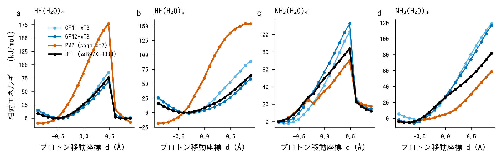
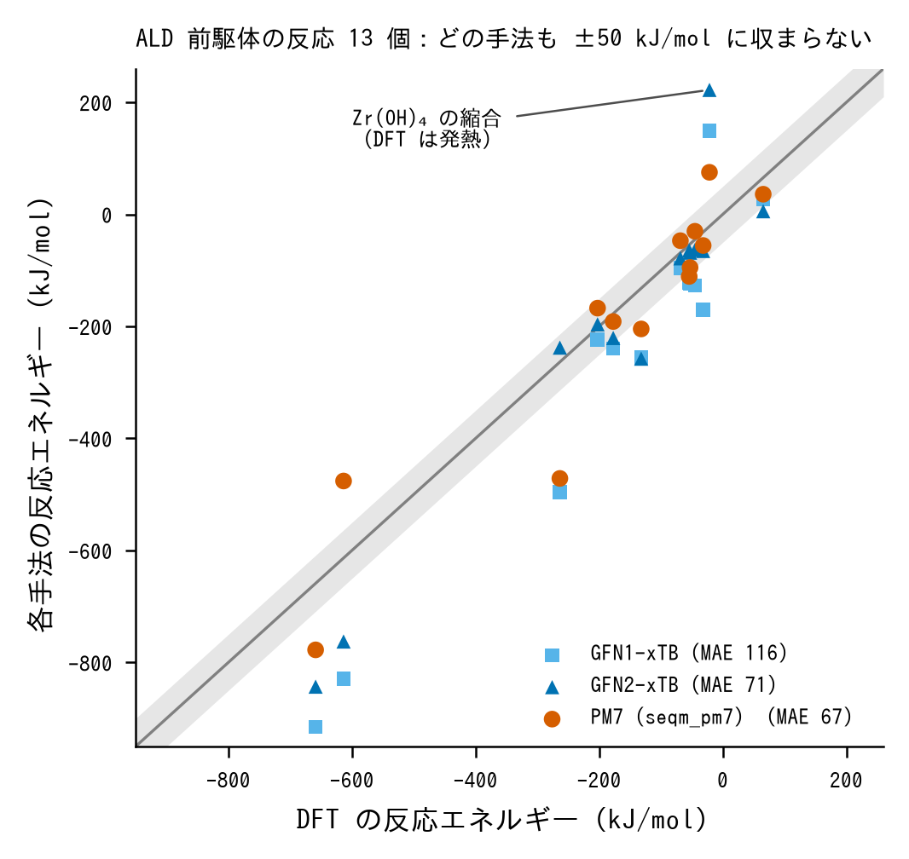

# seqm_pm7 v0.5（PM7）と xTB 系（GFN2-xTB・GFN1-xTB）の比較：精度・速度・適用範囲

作成日：2026-10-20。
参照の DFT は ωB97X-D3BJ/def2-TZVPD（Zr・Hf は def2 の有効内殻ポテンシャル、gpu4pyscf）。
xTB は xtb 6.7.1、PM7・PM6 は seqm_pm7 v0.5（MOPAC 23.2.5 と一致することを確認済み）。

## 要点

1. **ALD 前駆体の反応エネルギーは、どちらの手法でも定量的に扱えない。**
   - 13 反応での DFT に対する平均絶対誤差は、PM7 が 67 kJ/mol、GFN2 が 71 kJ/mol、GFN1 が 116 kJ/mol だった。
   - 符号まで外れる反応がある。例えば Zr(OH)4 の縮合は、DFT では −22 kJ/mol だが、GFN2 は +222、PM7 は +75 kJ/mol になる。
2. **構造は、手法ごとに別の欠点がある。**
   - PM7 は AlMe3 のメチル基を大きく歪ませる（Al–C–H 77°・152°・77°）。また AlMe3·H2O 付加体を、障壁なしで CH4 脱離まで進めてしまう。DFT では付加体は極小として残る（Al–O 2.07 Å）。いずれも MOPAC の PM7 でも同じなので、手法自体の性質である。
   - GFN2 は、Hf のアミドと水酸化物の構造で、DFT の極小から PM7 より遠い（DFT のエネルギーで 77〜99 kJ/mol 高い）。
3. **水中のプロトン移動は、GFN2 が大幅によい。**
   - HF の電離では、PM7 の RMSE が 51〜68 kJ/mol に対し、GFN2 は 4.5〜5.6 kJ/mol だった。
   - NH3 の電離では、両者は同程度（9〜19 kJ/mol）だった。
4. **速度は大きさで逆転する。**
   - 150 原子以下では、GFN2（CPU）が 1 構造あたり 0.1〜0.7 s で最速である。seqm_pm7 は GPU で 8 構造まとめても 0.26〜0.85 s かかる。
   - 500〜1700 原子では、seqm_pm7（GPU 1 構造、打ち切り距離 10 Å、尾崎スキーム II）が 7〜14 s で、GFN2（8 スレッドで 12〜40 s）より速い。
5. **seqm_pm7 の強みは精度ではなく、計算の基盤としての性質にある。**
   - GPU でまとめて計算できる。
   - 自動微分で、パラメータについての微分まで得られる。
   - MOPAC と完全に一致する。
   - 精度の面ではむしろ、再フィットや Δ 学習の出発点として使うのが現実的である。

## 1. 精度 A：水中のプロトン移動（共通経路上の一点計算）

UMA の拘束スキャンで作った構造（各 19 点）の上で各手法を計算し、DFT と比べた（分子型の極小を基準にした相対エネルギー）。

| 系 | PM7 | PM6 | GFN2-xTB | GFN1-xTB | UMA（参考） |
|---|---|---|---|---|---|
| HF(H2O)4 | 51.0 | 22.5 | **4.5** | 4.1 | 0.5 |
| HF(H2O)8 | 68.0 | 39.9 | **5.6** | 13.4 | 0.6 |
| NH3(H2O)4 | 9.3 | 15.0 | 11.4 | 9.3 | 0.6 |
| NH3(H2O)8 | 17.4 | 14.2 | 16.1 | 19.0 | 0.8 |

（RMSE、kJ/mol。表は [proton_transfer_rmse.csv](proton_transfer_rmse.csv)、図は下）

- PM7 は HF の電離を大きく不利に見積もる（d = 0.5 Å で DFT の 2.3 倍）。PM7 の値は、以前 MOPAC 自身で得た値と一致する。
- GFN2 は HF ではよく、NH3 では過大で、PM7 と同程度の誤差になる。

## 2. 精度 B：ALD 前駆体の反応エネルギー（13 反応）

- **構造**：すべて GFN2 で最適化した同じ構造を使い、各手法で一点計算をした（固定構造の比較）。この比べ方は GFN2 にやや有利である。
- **PM7（自前の構造）**：PM7 自身で最適化した構造での値も並べた。
- **反応エネルギーの求め方**：PM7・PM6 は生成熱の差、xTB と DFT は全エネルギーの差から求めた。

| 手法 | 平均絶対誤差 | 平均符号付き誤差 | 最大誤差 |
|---|---|---|---|
| PM7 | 67.0 | −20.0 | 208 |
| GFN2-xTB | 71.2 | −28.8 | 244 |
| PM6 | 104.9 | +36.3 | 585 |
| GFN1-xTB | 115.8 | −89.5 | 256 |
| PM7（自前の構造、12 反応） | 106.9 | −7.3 | 241 |

（kJ/mol。各反応の値は [reaction_energies.csv](reaction_energies.csv)）

主な反応の値（DFT / GFN2 / PM7、kJ/mol）:

| 反応 | DFT | GFN2 | PM7 |
|---|---|---|---|
| ZrMe4 + H2O → ZrMe3OH + CH4 | −177 | −221 | −191 |
| AlMe3 + H2O → AlMe2OH + CH4 | −132 | −258 | −205 |
| TDMAZ + H2O → Zr(NMe2)3OH + HNMe2 | −53 | −68 | −95 |
| TDMAH + H2O → Hf(NMe2)3OH + HNMe2 | −45 | −64 | −30 |
| HfCl4 + H2O → HfCl3OH + HCl | +66 | +6 | +36 |
| 2 Zr(OH)4 → Zr2O2(OH)4 + 2 H2O | −22 | +222 | +75 |
| AlMe3 + H2O → AlMe3·H2O（付加体） | −69 | −79 | −47 |

- 反応ごとに、どちらがよいかが入れ替わる。GFN2 はアミドの加水分解と付加体の結合に強く、PM7 は ZrMe4 と HfCl4 でやや近い。
- 完全加水分解（M–Me × 4 → M(OH)4）では、どちらも誤差が 100〜190 kJ/mol に積み上がる。
- PM7 は自前の構造に緩和すると、Hf 系で誤差がかえって大きくなる（HfMe4 の 1 段目の加水分解：固定構造 −167 → 自前の構造 −87 kJ/mol、DFT は −203）。

### 構造の質（DFT で評価）
PM7 で最適化した構造で DFT の一点計算を行い、GFN2 の構造での DFT のエネルギーと比べた（[pm7_geometry_dft_check.csv](pm7_geometry_dft_check.csv)）。DFT のエネルギーが低いほうを、より DFT の極小に近い構造とみなす。

- **GFN2 の構造のほうがよい**（23 種中 11 種）：AlMe3（+306 kJ/mol）、AlMe2OH（+183）、HfCl4（+136）、HfCl3OH（+85）、ZrMe4（+50）など。
  - PM7 は Hf–Cl を 2.14 Å と、GFN2（2.24 Å）より大幅に短くする。
  - AlMe3 のメチル基は、PM7 では H が Al に橋をかける形に歪む。MOPAC 23.2.5 の PM7 でも同じ構造と生成熱になる（−20.33 kcal/mol）。
- **PM7 の構造のほうがよい**：Hf(NMe2)3OH（−99）、TDMAH（−84）、Hf(OH)4（−77）、ZrNMe23OH（−29）など。Hf のアミドと水酸化物では、GFN2 の構造が DFT の極小から遠い。
- **TMA·H2O 付加体**：PM7 で最適化すると、水の H がメチル基に移り、CH4 が脱離した。DFT（def2-SVP）で最適化すると付加体のまま残り（Al–O 2.07 Å）、GFN2 も付加体を保つ（Al–O 1.97 Å）。

## 3. 速度（単点計算と力）

| 系 | GFN2-xTB（CPU 4 スレッド） | GFN2-xTB（8 スレッド） | seqm_pm7（CPU 4 スレッド） | seqm_pm7（GPU 1 構造） | seqm_pm7（GPU 8 構造まとめて、1 構造あたり） | MOPAC PM7（1 スレッド） |
|---|---|---|---|---|---|---|
| TDMAZ（37 原子） | 0.1 s | 0.1 s | 0.95 s | 1.48 s | 0.26 s | 0.24 s |
| 4×Zr4O6(OH)4（72） | 0.5 s | 0.3 s | 3.77 s | 3.13 s | 0.85 s | 1.05 s |
| 4×TDMAZ（148） | 0.7 s | 0.5 s | 7.49 s | 3.15 s | 0.84 s | 1.26 s |
| 27×Zr4O6(OH)4（486） | 20.7 s | 19.2 s | ― | 8.1 s* | ― | 17.6 s |
| 27×TDMAZ（999） | 30.1 s | 11.7 s | ― | 7.4 s* | ― | 15.0 s |
| 27×HF(H2O)20（1674） | 95.4 s | 39.5 s | ― | 14.1 s* | ― | 47.8 s |

（[speed_comparison.csv](speed_comparison.csv)。* は打ち切り距離 10 Å と尾崎スキーム II による固有値計算の置き換えを使った値で、打ち切りの誤差は 5e-5 kcal/mol 以下。148 原子以下の seqm_pm7 は v0.4 の測定値で、v0.5 でも変わらない。測定はいずれも共有マシンで、日も違うので、倍率は目安。）

- 小さい系では、xtb は Fortran で書かれ、1 回の計算が 1 秒を切る。seqm_pm7 は PyTorch の呼び出しの遅延があり、GPU でまとめて計算してようやく MOPAC と同程度になる。
- 大きい系では、seqm_pm7 は GPU を使い、遠い原子対を省き、固有値計算を置き換えられるので速い。GFN2 には打ち切りを使っていない。

## 4. 適用範囲

| 項目 | seqm_pm7 v0.5（PM7） | xtb 6.7（GFN2/GFN1） |
|---|---|---|
| 元素 | パラメータは 72 元素分。MOPAC との一致を確かめたのは H・C・N・O・F・Al・Si・Cl・Zr・Hf | GFN2 は Z = 1〜86 |
| 開殻・多重度 | 閉殻のみ（`compute` に多重度の引数がない） | 指定できる（`--uhf`） |
| 溶媒 | なし | 暗黙溶媒モデル（ALPB、GBSA） |
| 周期境界 | なし（PYSEQM 本体にもない） | xtb 本体は分子系が中心 |
| 出力 | 生成熱（298 K 相当のパラメータ化） | 全エネルギー（熱化学補正は別途） |
| GPU・まとめ計算 | 対応（数〜数十構造をまとめて計算） | CPU（OpenMP） |
| 自動微分・パラメータ微分 | 対応（PyTorch。力とパラメータの微分） | 本体はなし。PyTorch 実装の dxtb がある（Friede ほか、J. Chem. Phys. 161, 062501, 2024） |
| 大きい系 | 打ち切り（PM7）と尾崎スキーム II で数千原子 | 1700 原子で 8 スレッド約 40 s（今回の測定） |
| 参照実装との一致 | MOPAC 23.2.5 と 0.004 kcal/mol 以内 | ― |

## 5. ALD プロジェクトでの使い分けの提案

1. **構造の予備最適化と配座探索**：
   - 基本は GFN2（CREST を含む）。
   - Hf のアミドと水酸化物では、GFN2 の構造が DFT の極小から遠いことがあるので、最終的には DFT で最適化し直す。
   - PM7 は、Al のメチル化合物と金属ハロゲン化物の構造を大きく誤るので、構造の最適化には使わない。
2. **反応エネルギーの定量**：
   - どちらも使わない。DFT か、DFT に合わせた MLIP（UMA など）を使う。
   - 半経験的手法を使うなら、PM7 のパラメータの再フィットか Δ 学習（seqm_pm7 の自動微分が活きる）を前提にする。
3. **水中のプロトン移動の傾向をつかむ**：PM7 より GFN2 が適する。ただし、UMA のほうが 1 桁よい。
4. **数百〜数千原子の大量の一点計算**：
   - seqm_pm7（GPU）が速い。
   - 精度の裏付けがない領域なので、DFT で検証した構造の範囲で使う。

## 6. 注意点

- DFT の参照値は 1 つの汎関数（ωB97X-D3BJ/def2-TZVPD）だけで、高精度な波動関数法による確認はしていない。
- 反応エネルギーは、GFN2 で最適化した構造での一点計算なので、GFN2 にやや有利である。「PM7（自前の構造）」の列は PM7 自身で最適化した構造だが、DFT は GFN2 の構造の値なので、構造の違いによる差も含む。
- PM7 の生成熱は 298 K の生成熱に合わせたパラメータ化なので、零点エネルギーと熱補正を暗に含む。DFT の電子エネルギーとの比較には、数 kJ/mol 程度の系統差がありうる（上の誤差に比べれば小さい）。
- 速度は共有マシンでの測定で、他のプロセスの負荷がある。

## このフォルダの中身
- `path/`：水中のプロトン移動の計算（`xtb_path.py`、各手法の結果 JSON、`path_summary.json`）
- `rxn/`：反応エネルギーの計算（構造の作成 `build.py`、DFT `dft.py`・`dft2.py`、集計 `rxn.py`、構造 `geo/`・`pm7opt/`、MOPAC の構造、結果 JSON）
- `speed/`：xtb の速度測定（`xtb_speed.py`、`xtb_speed.json`）
- CSV と図：上の表と図の元データ
- プロトン移動のスキャン構造（UMA の拘束スキャン）は含まない
